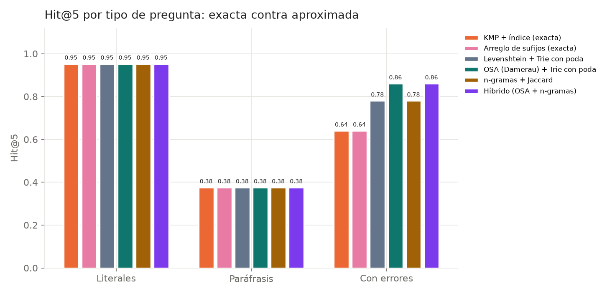
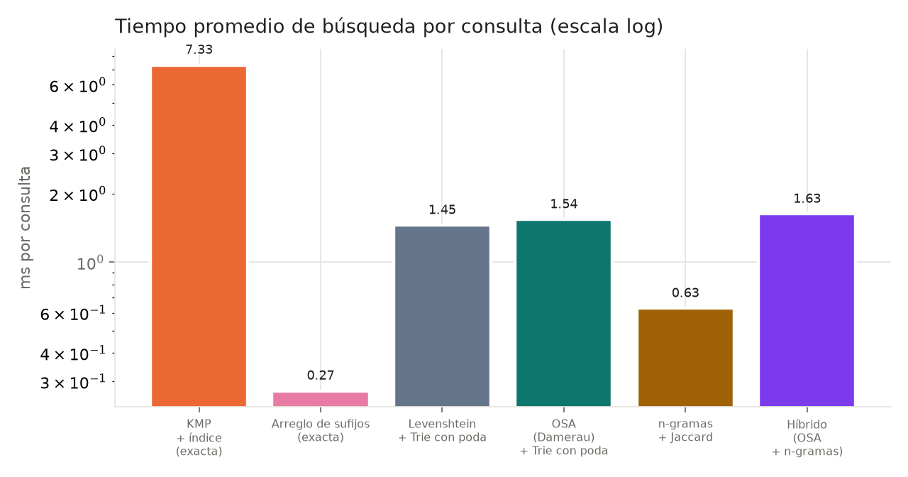
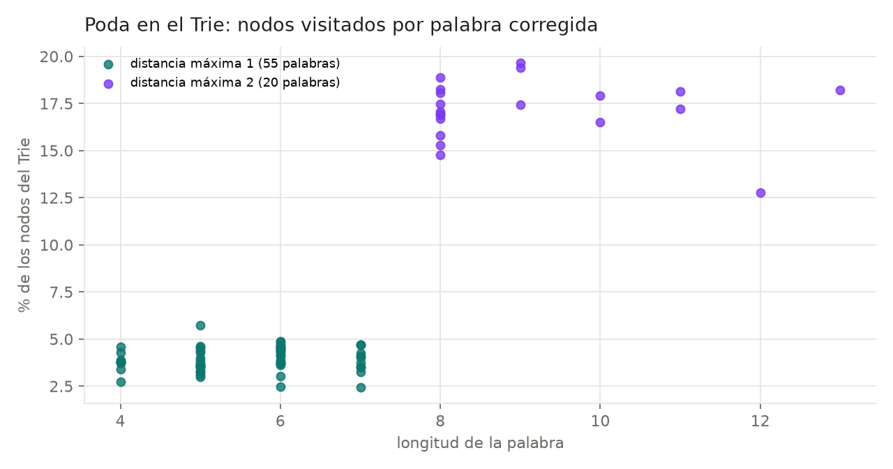
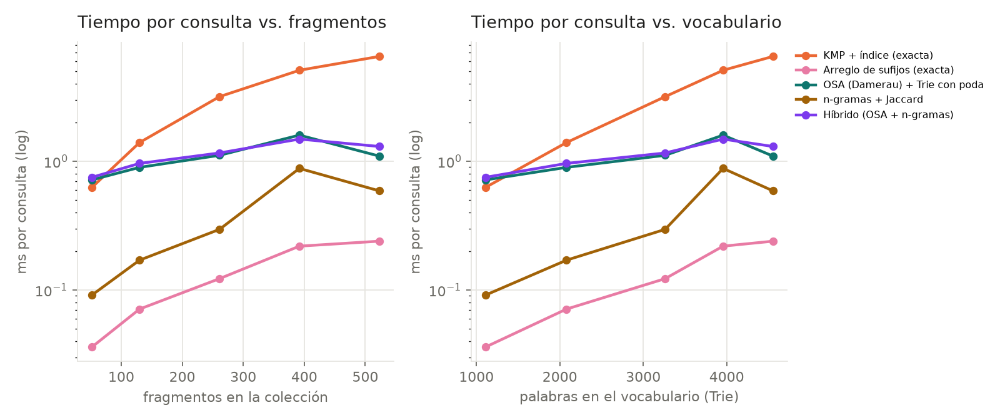
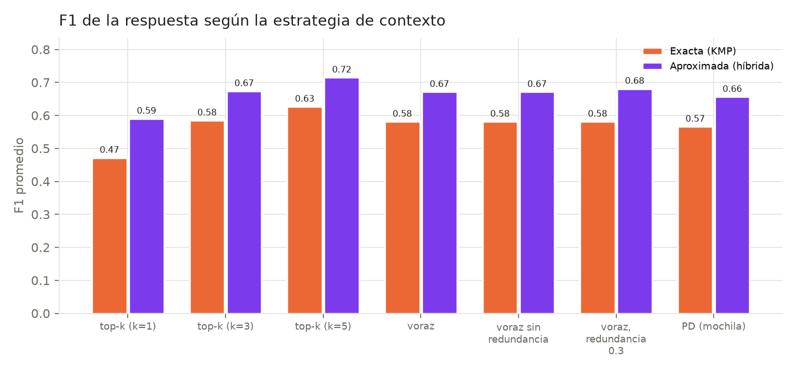
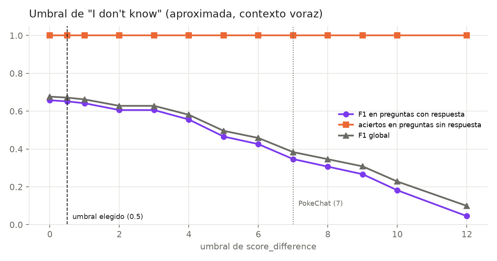

# Etapa 6 - Comparación de la búsqueda exacta contra la aproximada

Banco: **106 preguntas** de Ana (`load_questions()`, semilla 42). Tiempos de búsqueda: mediana de 3 repeticiones por pregunta. Top-5.

> Verificación: los números de la exacta (KMP) **coinciden** con `results/etapa6_exacta.json` de Ana.

## A. Exacta contra aproximada (recuperación)

| Método | Tiempo prom. (ms) | Mediana (ms) | Examinados | Recuperados (score>0) | Hit@1 | Hit@3 | Hit@5 | MRR | P@5 |
|---|---:|---:|---:|---:|---:|---:|---:|---:|---:|
| KMP + índice (exacta) | 7.329 | 5.974 | 166.9 | 166.9 | 0.540 | 0.690 | 0.750 | 0.627 | 0.258 |
| Arreglo de sufijos (exacta) | 0.273 | 0.257 | 166.9 | 166.9 | 0.540 | 0.690 | 0.750 | 0.627 | 0.258 |
| Levenshtein + Trie con poda | 1.454 | 0.898 | 185.5 | 185.5 | 0.670 | 0.780 | 0.820 | 0.735 | 0.294 |
| OSA (Damerau) + Trie con poda | 1.541 | 0.931 | 191.6 | 191.6 | 0.710 | 0.820 | 0.860 | 0.773 | 0.310 |
| n-gramas + Jaccard | 0.628 | 0.524 | 185.0 | 185.0 | 0.650 | 0.770 | 0.820 | 0.721 | 0.288 |
| Híbrido (OSA + n-gramas) | 1.628 | 0.920 | 191.7 | 191.7 | 0.710 | 0.820 | 0.860 | 0.773 | 0.310 |

### Por categoría

| Método | Categoría | n | ms prom. | Examinados | Recuperados | Hit@1 | Hit@3 | Hit@5 | MRR | P@5 |
|---|---|---:|---:|---:|---:|---:|---:|---:|---:|---:|
| KMP + índice (exacta) | literal | 42 | 8.570 | 190.3 | 190.3 | 0.810 | 0.905 | 0.952 | 0.869 | 0.352 |
| KMP + índice (exacta) | paraphrase | 8 | 10.149 | 229.0 | 229.0 | 0.250 | 0.375 | 0.375 | 0.312 | 0.100 |
| KMP + índice (exacta) | typo | 50 | 6.245 | 144.7 | 144.7 | 0.360 | 0.560 | 0.640 | 0.475 | 0.204 |
| KMP + índice (exacta) | no_answer | 6 | 3.912 | 104.5 | 104.5 | — | — | — | — | — |
| Arreglo de sufijos (exacta) | literal | 42 | 0.335 | 190.3 | 190.3 | 0.810 | 0.905 | 0.952 | 0.869 | 0.352 |
| Arreglo de sufijos (exacta) | paraphrase | 8 | 0.351 | 229.0 | 229.0 | 0.250 | 0.375 | 0.375 | 0.312 | 0.100 |
| Arreglo de sufijos (exacta) | typo | 50 | 0.220 | 144.7 | 144.7 | 0.360 | 0.560 | 0.640 | 0.475 | 0.204 |
| Arreglo de sufijos (exacta) | no_answer | 6 | 0.178 | 104.5 | 104.5 | — | — | — | — | — |
| Levenshtein + Trie con poda | literal | 42 | 0.581 | 190.3 | 190.3 | 0.810 | 0.905 | 0.952 | 0.869 | 0.352 |
| Levenshtein + Trie con poda | paraphrase | 8 | 0.891 | 231.4 | 231.4 | 0.250 | 0.375 | 0.375 | 0.312 | 0.100 |
| Levenshtein + Trie con poda | typo | 50 | 2.314 | 183.5 | 183.5 | 0.620 | 0.740 | 0.780 | 0.690 | 0.276 |
| Levenshtein + Trie con poda | no_answer | 6 | 1.143 | 107.0 | 107.0 | — | — | — | — | — |
| OSA (Damerau) + Trie con poda | literal | 42 | 0.548 | 190.3 | 190.3 | 0.810 | 0.905 | 0.952 | 0.869 | 0.352 |
| OSA (Damerau) + Trie con poda | paraphrase | 8 | 0.871 | 231.4 | 231.4 | 0.250 | 0.375 | 0.375 | 0.312 | 0.100 |
| OSA (Damerau) + Trie con poda | typo | 50 | 2.523 | 196.6 | 196.6 | 0.700 | 0.820 | 0.860 | 0.767 | 0.308 |
| OSA (Damerau) + Trie con poda | no_answer | 6 | 1.200 | 107.0 | 107.0 | — | — | — | — | — |
| n-gramas + Jaccard | literal | 42 | 0.544 | 190.3 | 190.3 | 0.810 | 0.905 | 0.952 | 0.869 | 0.352 |
| n-gramas + Jaccard | paraphrase | 8 | 0.722 | 230.6 | 230.6 | 0.250 | 0.375 | 0.375 | 0.312 | 0.100 |
| n-gramas + Jaccard | typo | 50 | 0.715 | 182.9 | 182.9 | 0.580 | 0.720 | 0.780 | 0.662 | 0.264 |
| n-gramas + Jaccard | no_answer | 6 | 0.362 | 104.7 | 104.7 | — | — | — | — | — |
| Híbrido (OSA + n-gramas) | literal | 42 | 0.540 | 190.3 | 190.3 | 0.810 | 0.905 | 0.952 | 0.869 | 0.352 |
| Híbrido (OSA + n-gramas) | paraphrase | 8 | 0.896 | 231.4 | 231.4 | 0.250 | 0.375 | 0.375 | 0.312 | 0.100 |
| Híbrido (OSA + n-gramas) | typo | 50 | 2.700 | 196.6 | 196.6 | 0.700 | 0.820 | 0.860 | 0.767 | 0.308 |
| Híbrido (OSA + n-gramas) | no_answer | 6 | 1.293 | 107.2 | 107.2 | — | — | — | — | — |

En `no_answer` no hay métricas de ranking (no existe fragmento relevante); solo tiempo y recuperados.

## B. Casos parecidos y casos distintos (exacta KMP contra aproximada híbrida)

Conteos sobre las preguntas con respuesta: mismo top-1 relevante en 52; solo la aproximada tiene un relevante en el top-5 en 11; la exacta es mejor (Hit@5, o Hit@1 si ambas tienen Hit@5) en 1.

### Ambos métodos coinciden en el top-1 relevante

**Q02** [literal] When was Pluto reclassified as a dwarf planet? · relevantes: [385, 386] · correcciones: ninguna

| # | Exacta | Aproximada |
|---|---|---|
| 1 | 385 ✓ · Pluto Facts > Dwarf Planets · 35.30 | 385 ✓ · Pluto Facts > Dwarf Planets · 36.39 |
| 2 | 386 ✓ · Pluto Facts > Introduction · 32.11 | 386 ✓ · Pluto Facts > Introduction · 32.38 |
| 3 | 384 · About the Planets > Ceres Facts / Pluto Facts / Haumea Facts / Ma · 28.94 | 384 · About the Planets > Ceres Facts / Pluto Facts / Haumea Facts / Ma · 29.14 |

**Q03** [literal] When did New Horizons fly by Pluto? · relevantes: [337, 338, 340, 348, 349, 350, 353, 388, 389, 390] · correcciones: ninguna

| # | Exacta | Aproximada |
|---|---|---|
| 1 | 338 ✓ · New Horizons Mission > What is New Horizons? · 27.26 | 338 ✓ · New Horizons Mission > What is New Horizons? · 27.56 |
| 2 | 347 · New Horizons Mission > In Depth: New Horizons · 24.89 | 347 · New Horizons Mission > In Depth: New Horizons · 25.00 |
| 3 | 358 · New Horizons Mission > New Horizons Stories · 22.43 | 358 · New Horizons Mission > New Horizons Stories · 22.61 |

**Q05** [literal] How many known moons does Pluto have? · relevantes: [387, 388, 395] · correcciones: ninguna

| # | Exacta | Aproximada |
|---|---|---|
| 1 | 395 ✓ · Pluto Facts > Moons · 9.95 | 395 ✓ · Pluto Facts > Moons · 9.97 |
| 2 | 396 · Pluto Facts > Moons · 9.82 | 396 · Pluto Facts > Moons · 9.84 |
| 3 | 388 ✓ · Pluto Facts > Introduction · 9.00 | 388 ✓ · Pluto Facts > Introduction · 9.02 |

### La aproximada acierta y la exacta falla

**Q01-T** [typo] When was Pluot discovered? · relevantes: [386, 389] · correcciones: pluot -> pluto (OSA d=1, peso 0.80)

| # | Exacta | Aproximada |
|---|---|---|
| 1 | 461 · Triton Facts > Contents / Discovery · 4.22 | 240 · Kuiper Belt Facts > Pluto's Place in the Kuiper Belt · 9.22 |
| 2 | 329 · Neptune Facts > Moons · 3.68 | 386 ✓ · Pluto Facts > Introduction · 9.19 |
| 3 | 328 · Neptune Facts > Moons · 3.63 | 389 ✓ · Pluto Facts > Namesake · 8.49 |

**Q13-T** [typo] How long is one day on Jpuiter? · relevantes: [199, 203] · correcciones: jpuiter -> jupiter (OSA d=1, peso 0.86)

| # | Exacta | Aproximada |
|---|---|---|
| 1 | 471 · Uranus Facts > Orbit and Rotation · 11.64 | 203 ✓ · Jupiter Facts > Orbit and Rotation · 13.78 |
| 2 | 488 · Venus Facts > Orbit and Rotation · 10.47 | 471 · Uranus Facts > Orbit and Rotation · 11.67 |
| 3 | 393 · Pluto Facts > Orbit and Rotation · 9.10 | 488 · Venus Facts > Orbit and Rotation · 10.50 |

**Q14-T** [typo] Who diocovered Uranus? · relevantes: [467, 468] · correcciones: diocovered -> discovered (OSA d=1, peso 0.90)

| # | Exacta | Aproximada |
|---|---|---|
| 1 | 478 · Uranus Facts > Magnetosphere · 5.35 | 467 ✓ · Uranus Facts > Introduction · 10.87 |
| 2 | 471 · Uranus Facts > Orbit and Rotation · 5.35 | 323 · Neptune Facts > Discovery and Namesake · 8.88 |
| 3 | 466 · Uranus Facts > Our Solar System · 5.33 | 240 · Kuiper Belt Facts > Pluto's Place in the Kuiper Belt · 6.57 |

### La exacta acierta y la aproximada falla o baja (ruido de la corrección)

**Q04-T** [typo] What is the lagest moon of Pluto? · relevantes: [387, 388, 395, 396, 397] · correcciones: lagest -> largest (OSA d=1, peso 0.86); lagest -> latest (OSA d=1, peso 0.83)

| # | Exacta | Aproximada |
|---|---|---|
| 1 | 395 ✓ · Pluto Facts > Moons · 7.74 | 424 · Solar System Facts > Moons · 14.21 |
| 2 | 396 ✓ · Pluto Facts > Moons · 7.64 | 388 ✓ · Pluto Facts > Introduction · 13.90 |
| 3 | 388 ✓ · Pluto Facts > Introduction · 7.00 | 116 · Ganymede Facts > Introduction · 13.84 |

## C. Evidencia de la poda (OSA sobre el Trie contra fuerza bruta)

Todas las palabras de las preguntas que no están en el vocabulario y se corrigen (75). Fuerza bruta = OSA contra las 4,693 palabras del vocabulario.

| Grupo | Palabras | Nodos visitados prom. | % del Trie | OSA + Trie (ms) | Fuerza bruta (ms) | Aceleración | Mismo resultado |
|---|---:|---:|---:|---:|---:|---:|---|
| todas | 75 | 1,058 | 7.5% | 1.30 | 30.4 | 40× | sí |
| d = 1 | 55 | 557 | 3.9% | 0.53 | 26.2 | 51× | sí |
| d = 2 | 20 | 2,436 | 17.2% | 3.42 | 42.2 | 12× | sí |

Detalle por palabra en `results/etapa6_aprox_poda.csv`.

## D. Ablaciones (calidad y tiempo)

| Factor | Variante | Algoritmo | Hit@5 | MRR | Hit@5 literal | Hit@5 typo | MRR typo | ms prom. |
|---|---|---|---:|---:|---:|---:|---:|---:|
| Regla de distancia | fija en 1 | hybrid | 0.860 | 0.773 | 0.952 | 0.860 | 0.767 | 1.140 |
| Regla de distancia | fija en 2 | hybrid | 0.860 | 0.773 | 0.952 | 0.860 | 0.767 | 2.721 |
| Regla de distancia | por longitud (elegida) | hybrid | 0.860 | 0.773 | 0.952 | 0.860 | 0.767 | 1.706 |
| n de los n-gramas | n = 2 (elegido) | ngram_jaccard | 0.820 | 0.721 | 0.952 | 0.780 | 0.662 | 0.656 |
| n de los n-gramas | n = 3 | ngram_jaccard | 0.750 | 0.650 | 0.952 | 0.640 | 0.521 | 0.484 |
| β (reordenamiento por Jaccard) | β = 0 | hybrid | 0.860 | 0.773 | 0.952 | 0.860 | 0.767 | 1.560 |
| β (reordenamiento por Jaccard) | β = 0.1 (elegido) | hybrid | 0.860 | 0.773 | 0.952 | 0.860 | 0.767 | 1.808 |
| β (reordenamiento por Jaccard) | β = 0.3 | hybrid | 0.860 | 0.768 | 0.952 | 0.860 | 0.757 | 1.736 |
| Bono por frases | con frases (elegido) | hybrid | 0.860 | 0.773 | 0.952 | 0.860 | 0.767 | 1.727 |
| Bono por frases | sin frases | hybrid | 0.840 | 0.740 | 0.929 | 0.840 | 0.718 | 1.551 |
| LCS de términos (γ) | γ = 0 (elegido) | hybrid | 0.860 | 0.773 | 0.952 | 0.860 | 0.767 | 1.671 |
| LCS de términos (γ) | γ = 0.5 | hybrid | 0.860 | 0.777 | 0.952 | 0.860 | 0.773 | 5.366 |
| LCS de términos (γ) | γ = 1.0 | hybrid | 0.860 | 0.777 | 0.952 | 0.860 | 0.773 | 5.424 |

## E. Tamaño de la colección

Consultas: 10 literales + 10 con errores. ms promedio por consulta. El Trie y el índice de n-gramas se reconstruyen con el vocabulario de cada subconjunto (sin stopwords).

| % | Fragmentos | Tokens | Vocabulario | Nodos Trie | Construir Trie (s) | Construir n-gramas (s) | KMP | Arreglo de sufijos | OSA + Trie | n-gramas | Híbrido |
|---:|---:|---:|---:|---:|---:|---:|---:|---:|---:|---:|---:|
| 10% | 52 | 3,618 | 1,111 | 4,212 | 0.001 | 0.002 | 0.63 | 0.04 | 0.72 | 0.09 | 0.75 |
| 25% | 130 | 7,950 | 2,080 | 7,064 | 0.013 | 0.004 | 1.40 | 0.07 | 0.90 | 0.17 | 0.96 |
| 50% | 261 | 16,711 | 3,262 | 10,453 | 0.003 | 0.016 | 3.17 | 0.12 | 1.11 | 0.30 | 1.16 |
| 75% | 392 | 24,092 | 3,957 | 12,442 | 0.004 | 0.019 | 5.09 | 0.22 | 1.60 | 0.88 | 1.49 |
| 100% | 523 | 31,637 | 4,555 | 14,056 | 0.025 | 0.006 | 6.52 | 0.24 | 1.10 | 0.59 | 1.30 |

## F. Efecto del contexto en el modelo

Modelo `deepset/roberta-base-squad2` con la lógica del PokeChat (umbral 0.5). Recuperación de 10 candidatos; top-k no usa presupuesto ni redundancia. "Evidencia" = algún fragmento relevante quedó en el contexto (solo preguntas con respuesta). "F1 sin umbral" = F1 del tramo que eligió el modelo antes de aplicar el umbral.

| Búsqueda | Estrategia | EM | F1 | F1 (con respuesta) | F1 sin umbral | "I don't know" | Aciertos sin respuesta | Evidencia | Fragmentos | Redundantes descartados | Tokens contexto / presupuesto | Truncadas | Modelo ms |
|---|---|---:|---:|---:|---:|---:|---:|---:|---:|---:|---:|---:|---:|
| Exacta (KMP) | top-k (k=1) | 0.453 | 0.472 | 0.440 | 0.440 | 0.48 | 1.000 | 0.540 | 1.0 | 0.00 | 125 / 490 | 0 | 45 |
| Exacta (KMP) | top-k (k=3) | 0.547 | 0.585 | 0.560 | 0.566 | 0.34 | 1.000 | 0.690 | 3.0 | 0.00 | 413 / 490 | 0 | 76 |
| Exacta (KMP) | top-k (k=5) | 0.585 | 0.627 | 0.604 | 0.610 | 0.29 | 1.000 | 0.750 | 5.0 | 0.00 | 685 / 490 | 0 | 75 |
| Exacta (KMP) | voraz | 0.547 | 0.581 | 0.556 | 0.561 | 0.29 | 1.000 | 0.690 | 4.5 | 0.13 | 431 / 490 | 0 | 77 |
| Exacta (KMP) | voraz sin redundancia | 0.547 | 0.581 | 0.556 | 0.561 | 0.29 | 1.000 | 0.690 | 4.5 | 0.00 | 429 / 490 | 0 | 135 |
| Exacta (KMP) | voraz, redundancia 0.3 | 0.547 | 0.581 | 0.556 | 0.561 | 0.30 | 1.000 | 0.690 | 4.3 | 0.80 | 425 / 490 | 0 | 135 |
| Exacta (KMP) | PD (mochila) | 0.538 | 0.566 | 0.540 | 0.546 | 0.30 | 1.000 | 0.680 | 4.4 | 0.13 | 459 / 490 | 0 | 137 |
| Aproximada (híbrida) | top-k (k=1) | 0.566 | 0.590 | 0.566 | 0.571 | 0.40 | 1.000 | 0.710 | 1.0 | 0.00 | 126 / 490 | 0 | 45 |
| Aproximada (híbrida) | top-k (k=3) | 0.623 | 0.674 | 0.654 | 0.660 | 0.26 | 1.000 | 0.820 | 3.0 | 0.00 | 417 / 490 | 0 | 101 |
| Aproximada (híbrida) | top-k (k=5) | 0.670 | 0.715 | 0.698 | 0.704 | 0.22 | 1.000 | 0.860 | 5.0 | 0.00 | 696 / 490 | 0 | 137 |
| Aproximada (híbrida) | voraz | 0.632 | 0.671 | 0.652 | 0.657 | 0.24 | 1.000 | 0.790 | 4.3 | 0.09 | 433 / 490 | 0 | 120 |
| Aproximada (híbrida) | voraz sin redundancia | 0.632 | 0.671 | 0.652 | 0.657 | 0.24 | 1.000 | 0.790 | 4.3 | 0.00 | 431 / 490 | 0 | 139 |
| Aproximada (híbrida) | voraz, redundancia 0.3 | 0.642 | 0.681 | 0.662 | 0.667 | 0.24 | 1.000 | 0.790 | 4.2 | 0.80 | 425 / 490 | 0 | 136 |
| Aproximada (híbrida) | PD (mochila) | 0.623 | 0.656 | 0.636 | 0.641 | 0.25 | 1.000 | 0.800 | 4.3 | 0.09 | 459 / 490 | 0 | 140 |

**Umbral de redundancia (REDUNDANCY_JACCARD = 0.5).** Jaccard de raíces entre fragmentos consecutivos del mismo documento (485 pares): mediana 0.116, p90 0.355, máximo 0.614. Entre pares al azar (2000): mediana 0.031, p99 0.152, máximo 0.636.

| Umbral | Pares consecutivos que lo superan | Pares al azar que lo superan |
|---:|---:|---:|
| 0.2 | 188 | 7 |
| 0.3 | 96 | 3 |
| 0.4 | 22 | 2 |
| 0.5 | 6 | 1 |

## G. Umbral de "I don't know"

Barrido sobre las respuestas ya calculadas (no se vuelve a correr el modelo): con umbral t, la respuesta es el tramo del modelo si score_difference ≥ t. El sistema usa t = 0.5, calibrado con calibrar_umbral.py (el PokeChat usaba 7).

| Búsqueda / estrategia | t=0 | t=0.5 | t=1 | t=2 | t=3 | t=4 | t=5 | t=6 | t=7 | t=8 | t=9 | t=10 | t=12 |
|---|---:|---:|---:|---:|---:|---:|---:|---:|---:|---:|---:|---:|---:|
| approximate / greedy · F1 con respuesta | 0.657 | 0.652 | 0.642 | 0.606 | 0.606 | 0.556 | 0.466 | 0.426 | 0.347 | 0.307 | 0.267 | 0.182 | 0.045 |
| approximate / greedy · aciertos sin respuesta | 1.000 | 1.000 | 1.000 | 1.000 | 1.000 | 1.000 | 1.000 | 1.000 | 1.000 | 1.000 | 1.000 | 1.000 | 1.000 |
| approximate / topk1 · F1 con respuesta | 0.571 | 0.566 | 0.556 | 0.526 | 0.506 | 0.476 | 0.406 | 0.396 | 0.317 | 0.277 | 0.237 | 0.162 | 0.035 |
| approximate / topk1 · aciertos sin respuesta | 1.000 | 1.000 | 1.000 | 1.000 | 1.000 | 1.000 | 1.000 | 1.000 | 1.000 | 1.000 | 1.000 | 1.000 | 1.000 |
| exact / greedy · F1 con respuesta | 0.561 | 0.556 | 0.546 | 0.500 | 0.500 | 0.480 | 0.400 | 0.370 | 0.307 | 0.267 | 0.237 | 0.152 | 0.035 |
| exact / greedy · aciertos sin respuesta | 1.000 | 1.000 | 1.000 | 1.000 | 1.000 | 1.000 | 1.000 | 1.000 | 1.000 | 1.000 | 1.000 | 1.000 | 1.000 |

En las preguntas sin respuesta, el modelo eligió el token `<s>` (sin tramo) en 84 de 84 corridas; por eso aciertan con cualquier umbral.

### score_difference de los tramos correctos según el contexto (aproximada)

| Estrategia | Tramos correctos | Tokens de contexto prom. | score_difference prom. | Mediana | % ≥ umbral |
|---|---:|---:|---:|---:|---:|
| top-k (k=1) | 59 | 125 | 7.522 | 7.714 | 98% |
| top-k (k=3) | 69 | 425 | 7.547 | 7.714 | 99% |
| top-k (k=5) | 73 | 708 | 7.757 | 7.714 | 99% |
| voraz | 68 | 432 | 7.429 | 7.215 | 99% |
| voraz sin redundancia | 68 | 430 | 7.429 | 7.215 | 99% |
| voraz, redundancia 0.3 | 69 | 423 | 7.466 | 7.216 | 99% |
| PD (mochila) | 67 | 460 | 7.578 | 8.458 | 99% |

## H. Mochila voraz contra programación dinámica

| Búsqueda | Preguntas | Conjuntos distintos | Diferencia de valor prom. (PD − voraz) | Máxima | % prom. | Respuesta cambió | F1 voraz | F1 PD | Selección voraz (ms) | Selección PD (ms) |
|---|---:|---:|---:|---:|---:|---:|---:|---:|---:|---:|
| Exacta (KMP) | 106 | 50 | 0.0643 | 0.4625 | 1.68% | 6 | 0.581 | 0.566 | 0.6 | 0.8 |
| Aproximada (híbrida) | 106 | 54 | 0.0787 | 0.5316 | 1.98% | 5 | 0.671 | 0.656 | 0.5 | 0.7 |

Ejemplos donde eligen conjuntos distintos:

- Q02 (Exacta (KMP)): voraz [385, 386, 321, 380, 338] (valor 4.076) → "2006"; PD [385, 386, 384, 321] (valor 4.538) → "2006"
- Q04 (Exacta (KMP)): voraz [116, 388, 456] (valor 3.657) → "Charon"; PD [116, 388, 462] (valor 3.921) → "Charon"
- Q05 (Exacta (KMP)): voraz [388, 399, 424, 339] (valor 5.092) → "five"; PD [395, 396, 399, 339] (valor 5.436) → "five"
- Q06 (Exacta (KMP)): voraz [272, 103, 472, 408] (valor 2.664) → "Phobos and Deimos"; PD [272, 103, 472, 19] (valor 2.692) → "Phobos and Deimos"
- Q07 (Exacta (KMP)): voraz [278, 135, 118, 402, 466, 199] (valor 4.971) → "Olympus Mons"; PD [278, 135, 118, 402, 434, 466] (valor 4.993) → "Olympus Mons"
- Q02 (Aproximada (híbrida)): voraz [385, 386, 321, 380, 338] (valor 4.025) → "2006"; PD [385, 386, 384, 321] (valor 4.473) → "2006"

El tiempo de selección incluye contar tokens (con caché) y eliminar redundancia; la tabla de la PD tiene unas N·W ≈ 10 × 490 celdas.

## I. Datos para el análisis

- **¿Qué algoritmo es más rápido?** Arreglo de sufijos (exacta) (0.273 ms promedio). KMP + índice: 7.329 ms. De las aproximadas, n-gramas + Jaccard (0.628 ms); híbrido 1.628 ms.
- **¿Qué método recupera información más útil?** OSA (Damerau) + Trie con poda: Hit@5 0.860, MRR 0.773 (KMP: Hit@5 0.750, MRR 0.627). En preguntas con errores: Hit@5 0.640 → 0.860, MRR 0.475 → 0.767. Literales: 0.952 (exacta) contra 0.952 (híbrida). Paráfrasis: 0.375 contra 0.375.
- **Errores de escritura, OSA contra Levenshtein:** Hit@5 typo 0.860 contra 0.780 (el generador de errores intercambia letras).
- **Poda:** OSA sobre el Trie visita en promedio 7.5% de los nodos y es 40× más rápido que la fuerza bruta, con el mismo resultado.
- **¿Cómo afecta el tamaño de la colección?** De 52 a 523 fragmentos (×10.1) el vocabulario crece ×4.1 (1,111 → 4,555). Tiempo por consulta: KMP 0.63 → 6.52 ms; OSA + Trie 0.72 → 1.10 ms; n-gramas 0.09 → 0.59 ms; arreglo de sufijos 0.04 → 0.24 ms.
- **¿Cómo afecta la selección del contexto?** Mejor F1: Aproximada (híbrida) con top-k (k=5) (0.715). Aproximada: top-1 0.590, top-3 0.674, top-5 0.715 (0 truncadas), voraz 0.671, PD 0.656. Evidencia en el contexto: top-1 0.71 contra voraz 0.79.
- **Voraz contra PD:** eligen conjuntos distintos en 54 de 106 preguntas; diferencia de valor promedio 1.98%; la respuesta cambió en 5.
- **Umbral:** con t = 0.5 (el elegido) el F1 global de la aproximada con contexto voraz es 0.671, contra 0.384 con t = 7 del PokeChat; el mejor del barrido es t = 0 con 0.677 (F1 con respuesta 0.657, aciertos sin respuesta 1.000).
- **Ventajas y limitaciones:** la aproximada corrige errores de escritura con poco costo extra y no empeora las literales; no resuelve sinónimos (paráfrasis sin cambio) ni errores que forman otra palabra real; la corrección empeoró el ranking en 1 pregunta(s) (sección B).

## Gráficas

