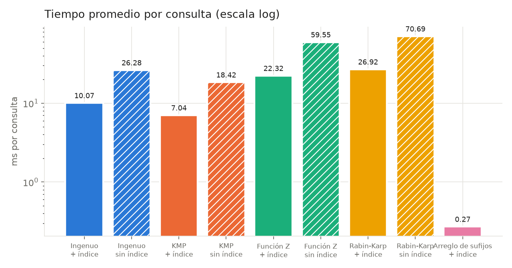
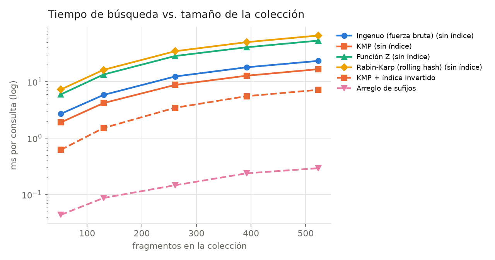
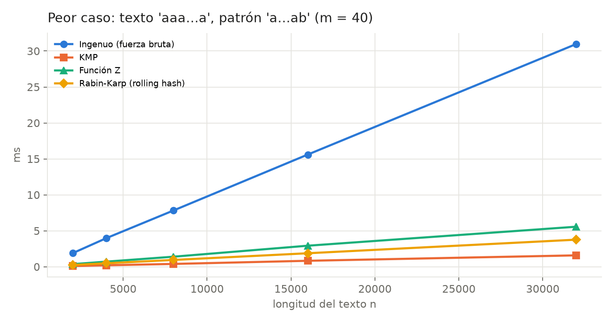
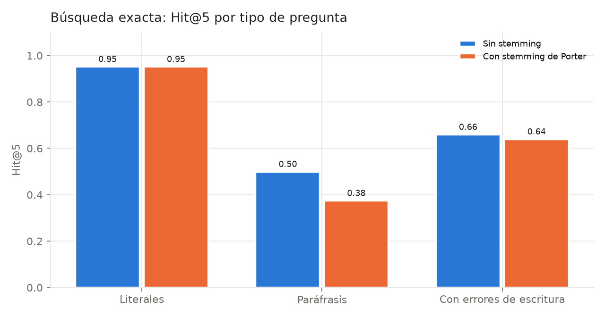

# Etapa 6 - Análisis de la búsqueda exacta

Banco de pruebas: **106 preguntas** (escritas a mano + variantes con errores de escritura).

## A. Comparación de algoritmos

| Algoritmo | Índice invertido | Tiempo prom. (ms) | Mediana (ms) | Fragmentos examinados | Recuperados (score>0) | Hit@1 | Hit@5 | MRR | P@5 |
|---|---|---:|---:|---:|---:|---:|---:|---:|---:|
| Ingenuo (fuerza bruta) | sí | 10.074 | 8.378 | 166.9 | 166.9 | 0.540 | 0.750 | 0.627 | 0.258 |
| Ingenuo (fuerza bruta) | no | 26.276 | 28.092 | 523.0 | 166.9 | 0.540 | 0.750 | 0.627 | 0.258 |
| KMP | sí | 7.038 | 5.775 | 166.9 | 166.9 | 0.540 | 0.750 | 0.627 | 0.258 |
| KMP | no | 18.419 | 19.490 | 523.0 | 166.9 | 0.540 | 0.750 | 0.627 | 0.258 |
| Función Z | sí | 22.315 | 18.214 | 166.9 | 166.9 | 0.540 | 0.750 | 0.627 | 0.258 |
| Función Z | no | 59.546 | 62.908 | 523.0 | 166.9 | 0.540 | 0.750 | 0.627 | 0.258 |
| Rabin-Karp (rolling hash) | sí | 26.920 | 22.404 | 166.9 | 166.9 | 0.540 | 0.750 | 0.627 | 0.258 |
| Rabin-Karp (rolling hash) | no | 70.685 | 76.298 | 523.0 | 166.9 | 0.540 | 0.750 | 0.627 | 0.258 |
| Arreglo de sufijos | sí | 0.272 | 0.248 | 166.9 | 166.9 | 0.540 | 0.750 | 0.627 | 0.258 |

Todos los algoritmos devuelven exactamente el mismo ranking (son búsquedas exactas); solo cambia el tiempo. La calidad depende del criterio de puntuación, no del algoritmo.

## B. Calidad por tipo de pregunta (KMP + índice)

| Categoría | Preguntas | Hit@1 | Hit@3 | Hit@5 | MRR | Recuperados prom. |
|---|---:|---:|---:|---:|---:|---:|
| literal | 42 | 0.810 | 0.905 | 0.952 | 0.869 | 190.3 |
| paraphrase | 8 | 0.250 | 0.375 | 0.375 | 0.312 | 229.0 |
| no_answer | 6 | nan | nan | nan | nan | 104.5 |
| typo | 50 | 0.360 | 0.560 | 0.640 | 0.475 | 144.7 |

## C. Efecto del stemming (KMP + índice)

| Variante | Hit@1 | Hit@5 | MRR | Recuperados prom. |
|---|---:|---:|---:|---:|
| Sin stemming | 0.510 | 0.770 | 0.621 | 143.5 |
| Con stemming de Porter | 0.540 | 0.750 | 0.627 | 166.9 |

## D. Escalabilidad (10 preguntas literales, ms promedio por consulta)

| Fragmentos | Caracteres | Construcción índice+SA (s) | naive_scan | kmp_scan | z_scan | rabin_karp_scan | kmp_index | suffix_array_index |
|---:|---:|---:|---:|---:|---:|---:|---:|---:|
| 52 | 22,139 | 0.01 | 2.70 | 1.90 | 5.96 | 7.29 | 0.62 | 0.04 |
| 130 | 49,355 | 0.01 | 5.83 | 4.18 | 13.40 | 16.23 | 1.51 | 0.09 |
| 261 | 104,426 | 0.03 | 12.38 | 8.77 | 28.57 | 34.72 | 3.45 | 0.15 |
| 392 | 150,408 | 0.05 | 18.02 | 12.77 | 40.80 | 50.29 | 5.54 | 0.24 |
| 523 | 197,239 | 0.06 | 23.38 | 16.67 | 53.51 | 65.93 | 7.17 | 0.29 |

## E. Peor caso teórico (ms)

| n | Ingenuo (fuerza bruta) | KMP | Función Z | Rabin-Karp (rolling hash) |
|---:|---:|---:|---:|---:|
| 2,000 | 1.9 | 0.1 | 0.4 | 0.2 |
| 4,000 | 4.0 | 0.2 | 0.7 | 0.5 |
| 8,000 | 7.8 | 0.4 | 1.4 | 0.9 |
| 16,000 | 15.6 | 0.8 | 2.9 | 1.9 |
| 32,000 | 31.0 | 1.6 | 5.6 | 3.8 |

## Gráficas

